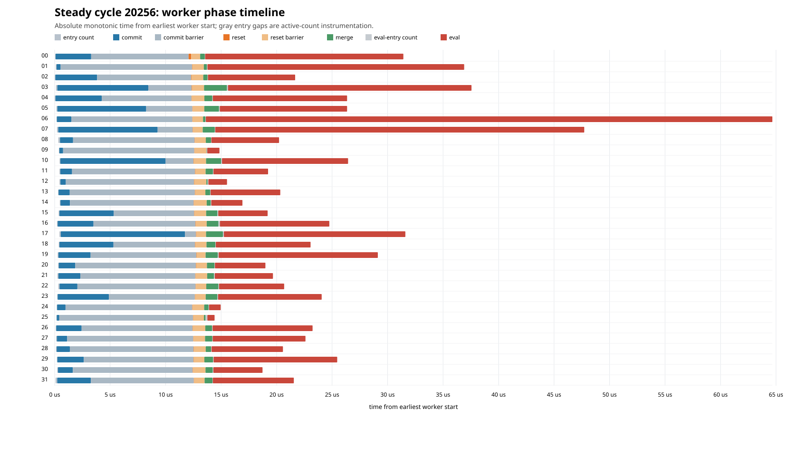
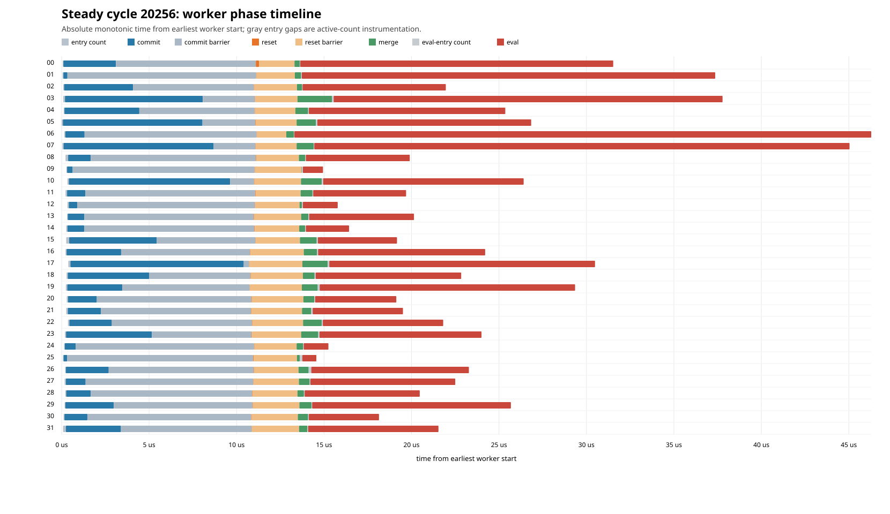

# RepCut 原子计数 barrier 优化（2026-11-15）

## 改动

在 `src/cppEmitter.cpp` 将 RepCut 两阶段 barrier 从“每个 worker 写独立 padded arrive 标记，worker 0 依次轮询所有标记，再广播 release”改为每阶段一个 padded 原子计数器和 parity。每个 worker 做一次 `fetch_add`；最后到达者清零计数并 release-store 当前 parity，其余 worker acquire-load parity 等待。实现只依赖 worker 数和 barrier phase，不依赖特定 RTL、CoreMark 状态或运行时活跃率。

32 worker 时，原 arrive/release 标记占 4,224 字节；新 barrier 状态占 128 字节，少 4,096 字节。计数器集中写入会增加 cache-line 争用，这是这项实现的代价。

## 性能与正确性

基线是本轮生成器改动前的 `build/xiangshan-repcut/gsim-compile/emu`，未插桩完整运行一次。候选由修改后的生成器按 `run-xiangshan.sh` 重生成并重编，未插桩运行两次。全部使用同一 CoreMark 镜像、`-b 0 -e 0 --no-diff`、`GSIM_THREADS=32`、`GSIM_MT_CPU_AFFINITY=auto` 和 `taskset -c 96-127`。

| 二进制 | Host time | Guest 结果 |
| --- | ---: | --- |
| 基线 | 15,626 ms | `instrCnt=663758`，`cycleCnt=290601`，`HIT GOOD TRAP`，CRC `e714 / 1fd7 / 8e3a / 72be` |
| 候选 1 | 15,058 ms | 与基线一致 |
| 候选 2 | 15,384 ms | 与基线一致 |
| 候选均值 | 15,221 ms | 与基线一致 |

按未插桩完整 Host time 均值计算，缩短 **2.59%**。这批数据是一条基线和两次候选运行；`--no-diff` 不构成逐信号等价验证。

## 阶段归因

下表来自独立插桩翻译单元的稳态 512 拍（epoch 20,000–20,511），仅用于归因，不能作为加速数字。跨度是每拍最晚 eval 结束减最早 worker 开工；各阶段的全局最大值来自不同 worker，不能相加。

| 诊断量 | 基线 | 候选 |
| --- | ---: | ---: |
| 平均全局周期跨度 | 54.120 us | 51.028 us |
| 最早开工至最后 commit 完成 | 11.533 us | 11.561 us |
| 最后 commit 至 commit barrier 释放 | 1.078 us | 0.935 us |
| reset barrier 释放至最后 eval 结束 | 41.509 us | 38.532 us |
| 最早 eval 开始至最后 eval 结束 | 40.695 us | 36.184 us |
| worker 6 eval 均值 / active 入口位 | 34.605 us / 706.3 | 28.315 us / 681.4 |
| worker 7 eval 均值 / active 入口位 | 32.053 us / 489.6 | 30.444 us / 479.4 |

worker 6 的按总耗时除以总入口位数为 48.99 → 41.56 ns/位；worker 7 为 65.47 → 63.51 ns/位。作为对照，worker 1 的 eval 是 21.363 → 21.419 us，入口位数均约 1,157。commit 工作量和 active 入口分布基本相同，说明静态分区没有变化。

每线程 barrier 调用时间显示第二阶段等待均值从 1.064 us 增至 2.537 us；因此这次收益不能解释为两个 barrier 都变快。观测到的全局 eval 尾部和完整 Host time 均缩短，可能同时受 worker 对齐及同步状态布局变化影响。计数器的集中争用仍是需要留意的代价。

稳态线程时间轴和 active 入口位热图：

## 验证

- 跨分区寄存器状态模型在 1、2、4 worker 下通过 ASan/UBSan。
- 异步 reset cascade 模型在 4 worker 下通过 ThreadSanitizer。
- 数组和异步 reset 边界回归通过。
- 多 logical partition 测试在 barrier 运行前因现有 partition 数量断言失败（期望 4、实际 2），不归因于 barrier。

生成器改动文件：`src/cppEmitter.cpp`。
